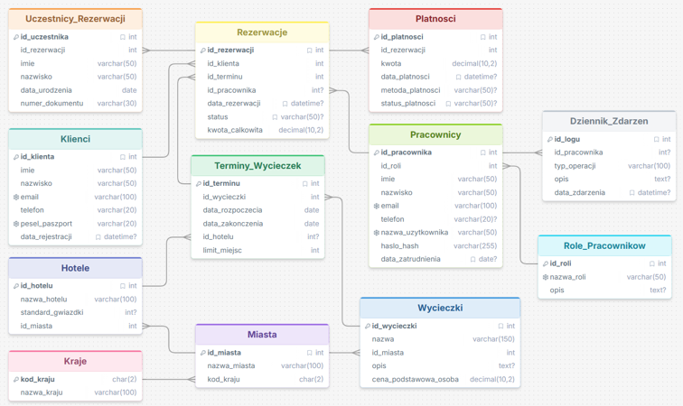

# RAPORT Z PROJEKTU BAZY DANYCH BIURA PODRÓŻY

**IMIĘ I NAZWISKO:** \[Twoje Imię i Nazwisko\]

**NR ALBUMU:** \[Twój Nr Albumu\]

**KIERUNEK:** Informatyka

**GRUPA LABORATORYJNA:** \[Twoja Grupa\]

## 1. OPIS ZADANIA

Baza danych została zaprojektowana w celu kompleksowego zarządzania i obsługi biura podróży. System umożliwia administrowanie słownikami lokalizacji, ofertą wycieczek i zakwaterowania, rejestracją klientów i pracowników, procesem rezerwacji oraz logowaniem zdarzeń systemowych.

Baza danych posiada następujące encje: **Kraje, Miasta, Hotele, Wycieczki, Klienci, Role_Pracownikow, Pracownicy, Terminy_Wycieczek, Rezerwacje, Uczestnicy_Rezerwacji, Platnosci, Dziennik_Zdarzen**.

### Struktura Powiązań

#### Gdzie i Z Kim? (Lokalizacje i Zakwaterowanie)

* **Kraj** posiada jedno lub wiele **Miast**. Każde **Miasto** musi należeć do jednego **Kraju**.

* W danym **Mieście** może znajdować się wiele **Hoteli**.

* **Wycieczka** jest przypisana do konkretnego docelowego **Miasta**.

#### Co i Kiedy Oferujemy? (Oferta i Terminy)

* **Wycieczka** definiuje podstawowe informacje o wyjeździe (nazwa, opis, cena podstawowa za osobę).

* Każda **Wycieczka** może mieć wielokrotnie generowane **Terminy_Wycieczek** (data rozpoczęcia i zakończenia, limit miejsc).

* **Termin_Wycieczki** opcjonalnie definiuje przydzielony **Hotel**.

#### Kto Obsługuje i Kto Korzysta? (Klienci i Pracownicy)

* **Klient** przechowuje unikalne dane identyfikacyjne (PESEL/Paszport, e-mail) oraz kontaktowe.

* Każdy **Pracownik** posiada przypisaną określoną **Rolę** (Agent, Kierownik, Administrator, Księgowy), która definiuje jego uprawnienia w systemie.

#### Jak Rezerwujemy i Płacimy? (Rezerwacje i Płatności)

* **Rezerwacja** łączy **Klienta** z wybranym **Terminem_Wycieczki**.

* **Rezerwacja** może być tworzona samodzielnie przez Klienta lub obsługiwana przez **Pracownika**.

* Do jednej **Rezerwacji** przypisany jest co najmniej jeden **Uczestnik_Rezerwacji** (dane uczestników wyjazdu).

* Do **Rezerwacji** przypisywane są **Platnosci** (kwota, metoda, status).

#### Audyt i Bezpieczeństwo (Dziennik Zdarzeń)

* **Dziennik_Zdarzen** rejestruje kluczowe operacje wykonywane przez **Pracowników** w systemie.

## 2. TABELA DANYCH ERD

| Element Danych | Obiekt | Typ Danych | Warunek na Wartość | 
| ----- | ----- | ----- | ----- | 
| **kod_kraju** | Kraje | CHAR(2) | OBOWIĄZKOWY (KLUCZ GŁÓWNY) | 
| **nazwa_kraju** | Kraje | VARCHAR(100) | OBOWIĄZKOWY | 
| **id_miasta** | Miasta | INT | OBOWIĄZKOWY (KLUCZ GŁÓWNY, AUTO_INCREMENT) | 
| **nazwa_miasta** | Miasta | VARCHAR(100) | OBOWIĄZKOWY | 
| **kod_kraju** | Miasta | CHAR(2) | OBOWIĄZKOWY (KLUCZ OBCY) | 
| **id_hotelu** | Hotele | INT | OBOWIĄZKOWY (KLUCZ GŁÓWNY, AUTO_INCREMENT) | 
| **nazwa_hotelu** | Hotele | VARCHAR(100) | OBOWIĄZKOWY | 
| **standard_gwiazdki** | Hotele | INT | OPCJONALNY | 
| **id_miasta** | Hotele | INT | OBOWIĄZKOWY (KLUCZ OBCY) | 
| **id_wycieczki** | Wycieczki | INT | OBOWIĄZKOWY (KLUCZ GŁÓWNY, AUTO_INCREMENT) | 
| **nazwa** | Wycieczki | VARCHAR(150) | OBOWIĄZKOWY | 
| **id_miasta** | Wycieczki | INT | OBOWIĄZKOWY (KLUCZ OBCY) | 
| **opis** | Wycieczki | TEXT | OPCJONALNY | 
| **cena_podstawowa_osoba** | Wycieczki | DECIMAL(10,2) | OBOWIĄZKOWY | 
| **id_klienta** | Klienci | INT | OBOWIĄZKOWY (KLUCZ GŁÓWNY, AUTO_INCREMENT) | 
| **imie** | Klienci | VARCHAR(50) | OBOWIĄZKOWY | 
| **nazwisko** | Klienci | VARCHAR(50) | OBOWIĄZKOWY | 
| **email** | Klienci | VARCHAR(100) | OBOWIĄZKOWY, Unikalny | 
| **telefon** | Klienci | VARCHAR(20) | OBOWIĄZKOWY | 
| **pesel_paszport** | Klienci | VARCHAR(20) | OBOWIĄZKOWY, Unikalny | 
| **data_rejestracji** | Klienci | DATETIME | OPCJONALNY (Domyślnie CURRENT_TIMESTAMP) | 
| **id_roli** | Role_Pracownikow | INT | OBOWIĄZKOWY (KLUCZ GŁÓWNY, AUTO_INCREMENT) | 
| **nazwa_roli** | Role_Pracownikow | VARCHAR(50) | OBOWIĄZKOWY, Unikalny, CHECK (Agent, Kierownik, Administrator, Księgowy) | 
| **opis** | Role_Pracownikow | TEXT | OPCJONALNY | 
| **id_pracownika** | Pracownicy | INT | OBOWIĄZKOWY (KLUCZ GŁÓWNY, AUTO_INCREMENT) | 
| **id_roli** | Pracownicy | INT | OBOWIĄZKOWY (KLUCZ OBCY) | 
| **imie** | Pracownicy | VARCHAR(50) | OBOWIĄZKOWY | 
| **nazwisko** | Pracownicy | VARCHAR(50) | OBOWIĄZKOWY | 
| **email** | Pracownicy | VARCHAR(100) | OBOWIĄZKOWY, Unikalny | 
| **telefon** | Pracownicy | VARCHAR(20) | OPCJONALNY | 
| **nazwa_uzytkownika** | Pracownicy | VARCHAR(50) | OBOWIĄZKOWY, Unikalny | 
| **haslo_hash** | Pracownicy | VARCHAR(255) | OBOWIĄZKOWY | 
| **data_zatrudnienia** | Pracownicy | DATE | OPCJONALNY (Domyślnie CURRENT_DATE) | 
| **id_terminu** | Terminy_Wycieczek | INT | OBOWIĄZKOWY (KLUCZ GŁÓWNY, AUTO_INCREMENT) | 
| **id_wycieczki** | Terminy_Wycieczek | INT | OBOWIĄZKOWY (KLUCZ OBCY) | 
| **data_rozpoczecia** | Terminy_Wycieczek | DATE | OBOWIĄZKOWY | 
| **data_zakonczenia** | Terminy_Wycieczek | DATE | OBOWIĄZKOWY | 
| **id_hotelu** | Terminy_Wycieczek | INT | OPCJONALNY (KLUCZ OBCY) | 
| **limit_miejsc** | Terminy_Wycieczek | INT | OBOWIĄZKOWY | 
| **id_rezerwacji** | Rezerwacje | INT | OBOWIĄZKOWY (KLUCZ GŁÓWNY, AUTO_INCREMENT) | 
| **id_klienta** | Rezerwacje | INT | OBOWIĄZKOWY (KLUCZ OBCY) | 
| **id_terminu** | Rezerwacje | INT | OBOWIĄZKOWY (KLUCZ OBCY) | 
| **id_pracownika** | Rezerwacje | INT | OPCJONALNY (KLUCZ OBCY) | 
| **data_rezerwacji** | Rezerwacje | DATETIME | OPCJONALNY (Domyślnie CURRENT_TIMESTAMP) | 
| **status** | Rezerwacje | VARCHAR(50) | OPCJONALNY (Domyślnie 'Oczekująca'), CHECK | 
| **kwota_calkowita** | Rezerwacje | DECIMAL(10,2) | OBOWIĄZKOWY | 
| **id_uczestnika** | Uczestnicy_Rezerwacji | INT | OBOWIĄZKOWY (KLUCZ GŁÓWNY, AUTO_INCREMENT) | 
| **id_rezerwacji** | Uczestnicy_Rezerwacji | INT | OBOWIĄZKOWY (KLUCZ OBCY, ON DELETE CASCADE) | 
| **imie** | Uczestnicy_Rezerwacji | VARCHAR(50) | OBOWIĄZKOWY | 
| **nazwisko** | Uczestnicy_Rezerwacji | VARCHAR(50) | OBOWIĄZKOWY | 
| **data_urodzenia** | Uczestnicy_Rezerwacji | DATE | OBOWIĄZKOWY | 
| **numer_dokumentu** | Uczestnicy_Rezerwacji | VARCHAR(30) | OBOWIĄZKOWY | 
| **id_platnosci** | Platnosci | INT | OBOWIĄZKOWY (KLUCZ GŁÓWNY, AUTO_INCREMENT) | 
| **id_rezerwacji** | Platnosci | INT | OBOWIĄZKOWY (KLUCZ OBCY, ON DELETE CASCADE) | 
| **kwota** | Platnosci | DECIMAL(10,2) | OBOWIĄZKOWY | 
| **data_platnosci** | Platnosci | DATETIME | OPCJONALNY (Domyślnie CURRENT_TIMESTAMP) | 
| **metoda_platnosci** | Platnosci | VARCHAR(50) | OPCJONALNY, CHECK | 
| **status_platnosci** | Platnosci | VARCHAR(50) | OPCJONALNY (Domyślnie 'Zrealizowana'), CHECK | 
| **id_logu** | Dziennik_Zdarzen | INT | OBOWIĄZKOWY (KLUCZ GŁÓWNY, AUTO_INCREMENT) | 
| **id_pracownika** | Dziennik_Zdarzen | INT | OPCJONALNY (KLUCZ OBCY, ON DELETE SET NULL) | 
| **typ_operacji** | Dziennik_Zdarzen | VARCHAR(100) | OBOWIĄZKOWY | 
| **opis** | Dziennik_Zdarzen | TEXT | OPCJONALNY | 
| **data_zdarzenia** | Dziennik_Zdarzen | DATETIME | OPCJONALNY (Domyślnie CURRENT_TIMESTAMP) | 

